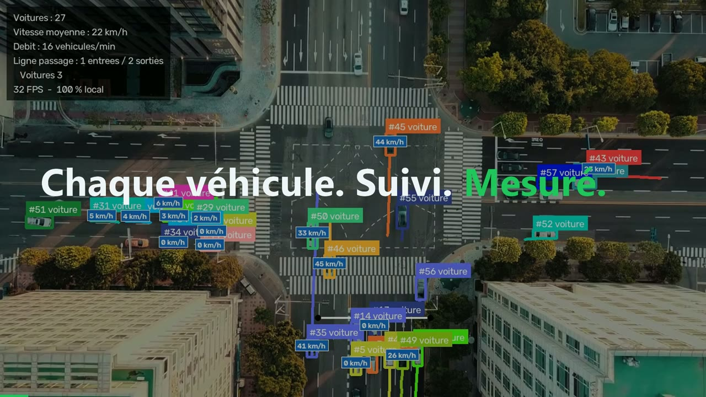
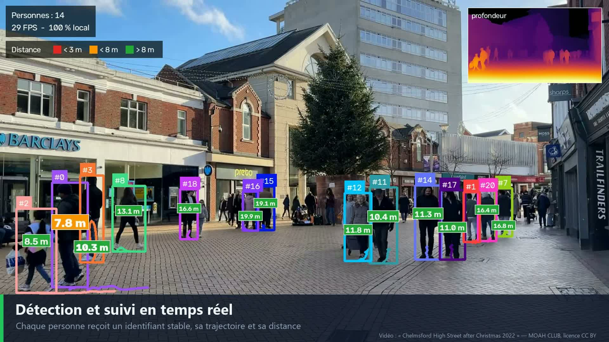
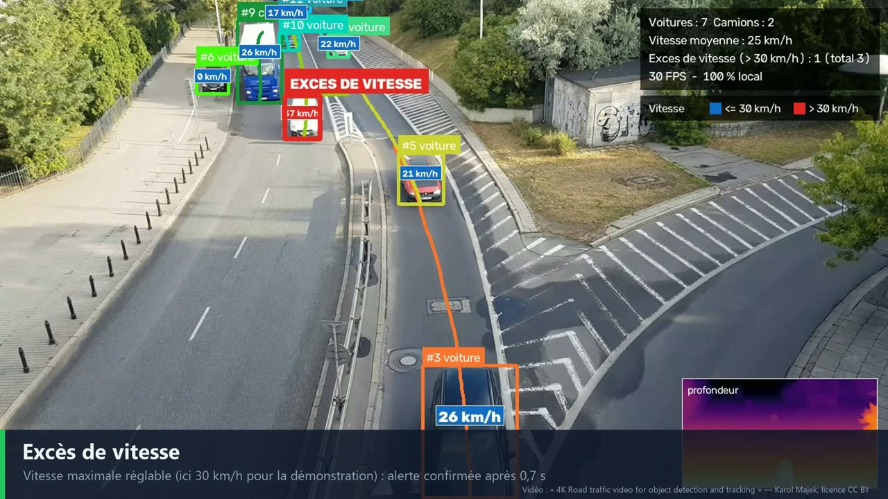
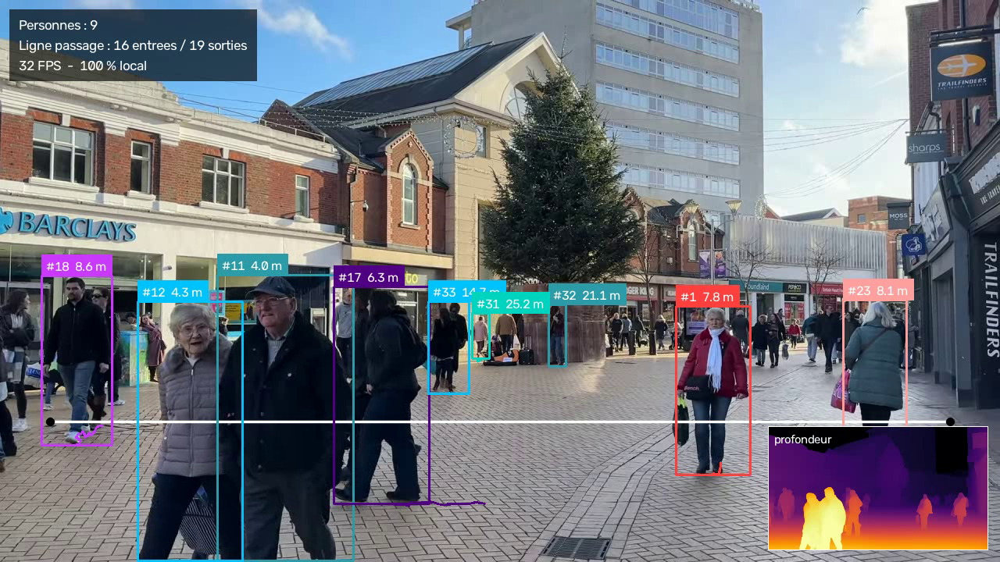
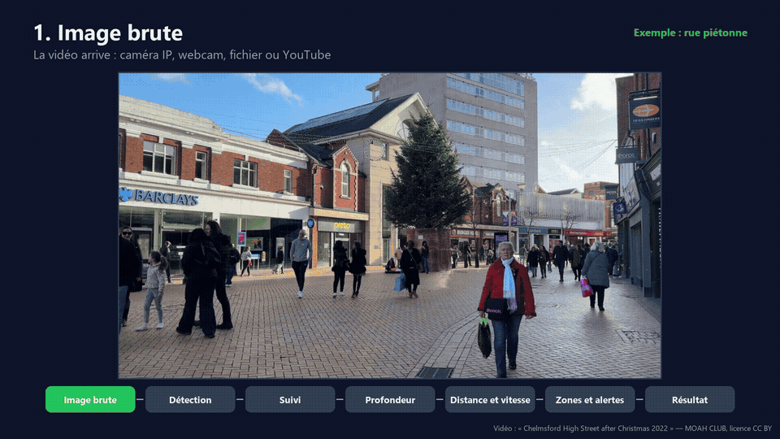
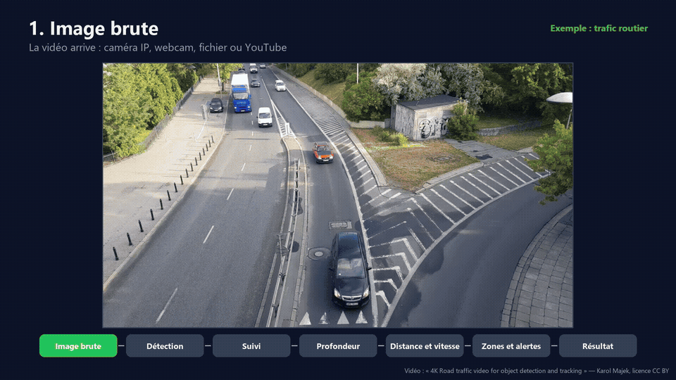

# VisionTrack

Détection, tracking et estimation de distance de personnes, et vitesse, excès de vitesse, contresens et comptage de véhicules, en temps réel sur GPU NVIDIA grand public.
**100 % local** : aucune image ne quitte le site.

[](https://github.com/PDUCLOS/visiontrack/releases/download/v0.3.1/visiontrack_reel_web.mp4)

▶ **[Voir la bande-démo (72 s)](https://github.com/PDUCLOS/visiontrack/releases/download/v0.3.1/visiontrack_reel_web.mp4)** : 17 exemples en 4 chapitres (vitesse, infractions, flux, personnes), chiffres mesurés incrustés. [Version 1080p](https://github.com/PDUCLOS/visiontrack/releases/download/v0.3.1/visiontrack_reel.mp4) · [Release v0.3.1](https://github.com/PDUCLOS/visiontrack/releases/tag/v0.3.1)

Démos détaillées :

[](https://github.com/PDUCLOS/visiontrack/releases/download/v0.2.0/visiontrack_demo_web.mp4)

▶ **[Voir la vidéo de démo (2 min 24)](https://github.com/PDUCLOS/visiontrack/releases/download/v0.2.0/visiontrack_demo_web.mp4)** : pipeline, 8 exemples (suivi, distance, foule dense, nuit, comptage, zone interdite, heatmap), réglages et comparatif rapide / précision. [Version 1080p](https://github.com/PDUCLOS/visiontrack/releases/download/v0.2.0/visiontrack_demo.mp4) · [Release v0.2.0](https://github.com/PDUCLOS/visiontrack/releases/tag/v0.2.0)

[](https://github.com/PDUCLOS/visiontrack/releases/download/v0.3.0/visiontrack_trafic_demo_web.mp4)

▶ **[Voir la démo véhicules (1 min 47)](https://github.com/PDUCLOS/visiontrack/releases/download/v0.3.0/visiontrack_trafic_demo_web.mp4)** : vitesse calibrée, excès de vitesse, contresens (simulation), carrefour et rond-point vus du ciel, voie rapide sans calibration. [Version 1080p](https://github.com/PDUCLOS/visiontrack/releases/download/v0.3.0/visiontrack_trafic_demo.mp4) · [Release v0.3.0](https://github.com/PDUCLOS/visiontrack/releases/tag/v0.3.0)



*Mesuré sur une RTX 4070 Ti SUPER, en 1280×720 : environ 28 à 30 images/s pour l'ensemble du traitement (détection RF-DETR medium, tracking, profondeur, distances, zones et rendu).*
*Vidéo source : « Chelmsford High Street after Christmas 2022 », licence CC BY.*

- **Détection** : [RF-DETR](https://huggingface.co/Roboflow/rf-detr-medium) (Apache 2.0) ou YOLO (Ultralytics, AGPL-3.0)
- **Tracking** : ByteTrack (via [supervision](https://github.com/roboflow/supervision)), avec des identifiants stables
- **Distance** : méthode géométrique, profondeur [Depth Anything V2](https://huggingface.co/depth-anything/Depth-Anything-V2-Small-hf), ou fusion des deux
- **Zones** : lignes de comptage entrées/sorties, zones interdites, heatmap de fréquentation
- **Sorties** : vidéo MP4 annotée et un fichier JSON Lines (une ligne par image : pistes, distances, zones)

Toute l'adaptation à un nouveau besoin se fait dans `config.yaml` : source vidéo, modèle, classes, zones, seuils.

## Le pipeline, étape par étape

Les animations ci-dessous sont produites par l'outil lui-même, sur de vraies images (`python demo/pipeline_animation.py`).

| Rue piétonne | Trafic routier |
|---|---|
|  |  |

## Matériel

Mesuré sur le PC de démo (RTX 4070 Ti SUPER, Ryzen 9 3900X, 32 Go), en 1280×720 :

- **29 images/s** pour le pipeline complet ;
- **40 images/s** en configuration légère ;
- **26 images/s sur CPU seul**, sans profondeur.

| Besoin | Configuration conseillée |
|---|---|
| Minimum sans GPU (comptage, zones, distance géométrique) | CPU 8 cœurs récent, 16 Go RAM |
| Minimum complet (1 caméra, toutes fonctions) | RTX 3060 12 Go ou RTX 4060, 6 à 8 cœurs, 16 Go RAM |
| Recommandé (1 à 2 caméras) | RTX 4070 / 4070 Ti, 8 à 12 cœurs, 32 Go RAM |
| Multi-caméras (4 à 8 flux) | RTX 4090 / L4, 16 cœurs, 64 Go RAM, TensorRT |

Le détail des mesures, la méthode et les estimations se trouvent dans [docs/MATERIEL.md](docs/MATERIEL.md). Les mesures se reproduisent avec `python demo/benchmark.py`.

## Trafic routier (profil véhicules)

```bash
python run.py --config config_trafic.yaml --source <vidéo ou URL> --show
```

Ce profil suit les voitures, camions, bus, motos et vélos (et les piétons) :

- **Vitesse** de chaque véhicule, en km/h. Elle est précise avec une calibration (`speed.calibration` : 4 points sur la route et leur taille réelle), et approchée sans calibration.
- **Excès de vitesse**, par rapport à la vitesse maximale `speed.limit_kmh`.
- **Sens de circulation** : dans `speed.lanes`, un polygone et une flèche par voie. Un véhicule qui roule dans l'autre sens déclenche l'alerte « CONTRESENS ».
- **Comptage par type** de véhicule, et **débit** en véhicules par minute.

Hauteurs de référence pour la distance (`distance.object_heights_m`) : voiture 1,9 m, camion 3,2 m, bus 3,0 m.

## Installation (Windows / Linux, x86 + GPU NVIDIA)

```bash
python -m venv .venv
.venv/Scripts/activate            # Linux : source .venv/bin/activate
pip install torch torchvision --index-url https://download.pytorch.org/whl/cu128
pip install -r requirements.txt
```

## Utilisation

```bash
# configuration par défaut
python run.py

# une vidéo YouTube, 20 s à partir de la 10e seconde, avec aperçu en direct
python run.py --source "https://www.youtube.com/watch?v=..." --start 10 --seconds 20 --show

# webcam, méthode de distance géométrique seule
python run.py --source 0 --distance pinhole --show
```

Les résultats sont écrits dans `outputs/`, et les vidéos YouTube sont mises en cache dans `data/videos/`.

## Interface de démonstration (locale)

```bash
python app.py   # puis ouvrir http://127.0.0.1:7860
```

Interface Gradio pour montrer l'outil en rendez-vous, **en direct** :

- **Sources** : 15 vidéos d'essai prêtes à l'emploi : 9 pour les personnes (suivi, distance côte à côte, comptage, zone interdite, personnes lointaines, heatmap, foule, nuit, cas difficile) et 6 pour le trafic (vitesse, excès de vitesse, contresens, carrefour et rond-point vus du ciel, voie rapide). Le choix « Type d'analyse » bascule entre Personnes et Trafic, et le volet « Trafic » règle la vitesse maximale et le sens des voies. Chaque essai règle l'extrait, la ligne et la zone. On peut aussi utiliser la **webcam** (caméra 0 à 3), un fichier, ou **n'importe quelle URL YouTube**. Une URL YouTube est lue directement en flux, sans téléchargement : même une vidéo de plusieurs heures démarre en quelques secondes, à l'endroit choisi. Pour travailler hors ligne, mettre `youtube_mode: download` dans `config.yaml`.
- **Affichage en direct** : l'image annotée et les statistiques (images/s, personnes, personne la plus proche, comptages, alertes) se mettent à jour pendant l'analyse. Le bouton **Arrêter** termine proprement l'analyse.
- **Mode temps réel** : la vidéo défile à sa vitesse réelle, comme une caméra, et les images qu'on n'a pas le temps d'analyser sont sautées.
- **Rapidité** : les modèles sont chargés au démarrage et restent en mémoire, donc chaque analyse démarre immédiatement.
- **Après l'analyse** : résumé, vidéo annotée complète et export JSON.
- **Retours** : formulaire « Votre avis » enregistré localement dans `feedback/feedback.jsonl`. Rien n'est envoyé sur le réseau.

En ligne de commande, l'équivalent est `python run.py --source 0 --show --realtime` pour la webcam dans une fenêtre.

## Estimation de distance

| Méthode | Principe | Quand l'utiliser |
|---|---|---|
| `pinhole` | distance = focale × 1,70 m / hauteur de la boîte | Rapide, personnes debout et entières |
| `depth` | carte de profondeur (métrique si le modèle est un « Metric ») | Scènes encombrées |
| `fusion` | profondeur relative recalée en mètres par la méthode géométrique | Par défaut, le plus stable |

Sans calibration de la caméra, on obtient une **estimation** (environ ±15–20 %). Pour une mission client, on renseigne le vrai champ de vision (`horizontal_fov_deg`) ou on calibre la caméra.

## Réglages pour de meilleurs résultats

Tous ces réglages se trouvent dans `config.yaml`.

| Objectif | Réglage | Effet / coût |
|---|---|---|
| Détecter les personnes lointaines | `detector.confidence: 0.30` | Plus de détections ; risque de quelques faux positifs |
| Plus de précision | `detector.model: large` | Meilleure détection des petites silhouettes, un peu plus lent |
| Petites silhouettes au loin | `resize_width: 1920` | Plus de pixels par personne, coût GPU plus élevé |
| Plus de vitesse | `detector.model: nano` ou `small`, `resize_width: 960` | Plus rapide, moins de détections lointaines |
| Distances justes | `distance.horizontal_fov_deg` = vrai champ de vision de la caméra | Corrige l'échelle de toutes les distances |
| Population particulière (enfants…) | `distance.person_height_m` | Taille de référence de la méthode géométrique |
| Personnes masquées (tables, voitures) | `distance.method: fusion` | La carte de profondeur prend le relais quand la silhouette est coupée |
| Distances moins « nerveuses » | `distance.smoothing: 0.4` | Lissage plus fort, réaction plus lente |
| Carte de profondeur plus fine | `distance.depth_input_size: 518`, `depth_every_n_frames: 1` | Profondeur plus détaillée et plus fluide, plus lente |
| ID stables malgré les occultations | `tracker.lost_track_buffer: 60` | Garde l'identité plus longtemps (≈ 2 s à 30 i/s) |
| Moins d'ID fantômes | `tracker.minimum_consecutive_frames: 5` | Une piste n'est créée qu'après 5 images |

**Mesure sur la même vidéo (Montréal)** : la vidéo de démo montre côte à côte le réglage rapide (`medium`, seuil 0,45, 1280 px) et le réglage précision (`large`, seuil 0,30, 1920 px), avec le nombre moyen de personnes détectées et la vitesse obtenue.

## Vidéo de démo

```bash
python demo/make_demo.py          # environ 2 minutes, en 1920×1080 H.264
python demo/make_demo.py --force  # recalcule toutes les scènes
python demo/make_demo.py --profile trafic   # démo véhicules, environ 1 min 47
python demo/make_reel.py                    # bande-démo rythmée de 72 s (à lancer après les deux démos)
```

La bande-démo enchaîne une accroche, 17 exemples de 3,4 s (vitesse, infractions, flux, personnes), trois bénéfices chiffrés et un appel à l'action. Pour chaque extrait, le passage le plus parlant est choisi à partir du JSON du pipeline, et le chiffre incrusté (vitesse max, alertes, véhicules à l'image) vient de ces mêmes données.

Le script fait tourner le vrai pipeline sur chaque scène, puis monte une vidéo de présentation dans `outputs/demo/visiontrack_demo.mp4` : titre, schéma du pipeline, 8 exemples (suivi, distance, foule dense, nuit, comptage ×2, zone interdite, heatmap), réglages, comparatif rapide / précision, et conclusion. Les vidéos sources sont sous licence CC BY et créditées à l'écran.

## Documentation

- [Argumentaire et storyboard de la vidéo de démo](docs/MARKETING.md)
- Schémas draw.io : [architecture](docs/diagrams/architecture.drawio), [local vs cloud](docs/diagrams/local_vs_cloud.drawio), [cas d'usage](docs/diagrams/use_cases.drawio)

## Licences des modèles

- RF-DETR, Depth Anything V2 Small : Apache 2.0, utilisables commercialement.
- Depth Anything V2 Base/Large et modèles « Metric » : vérifier la licence avant tout usage commercial.
- YOLO Ultralytics : AGPL-3.0, licence commerciale nécessaire pour un produit fermé.
